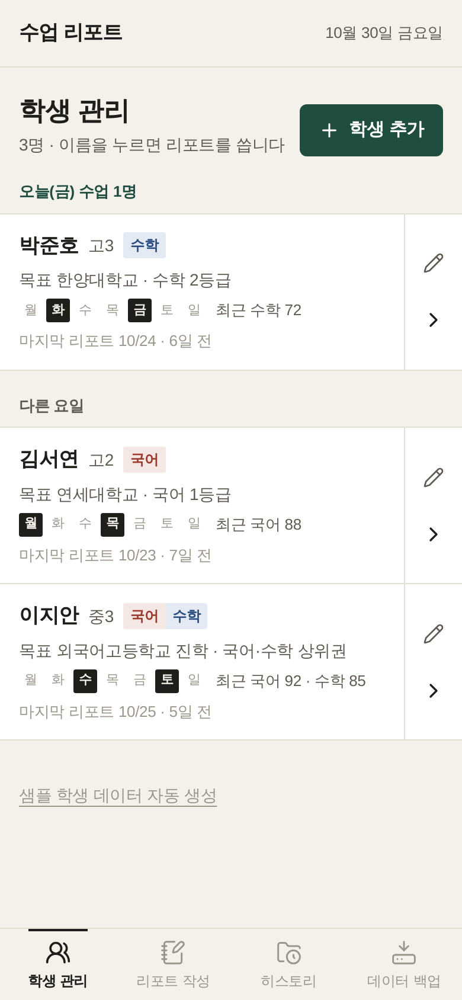
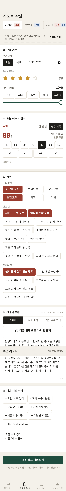
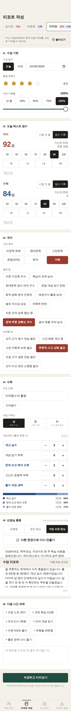
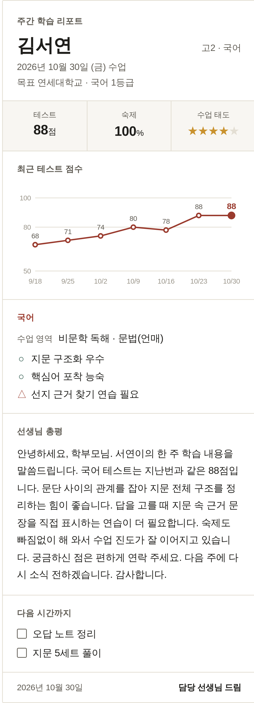
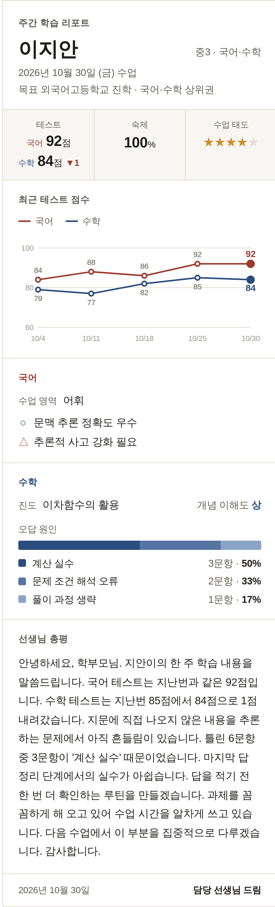
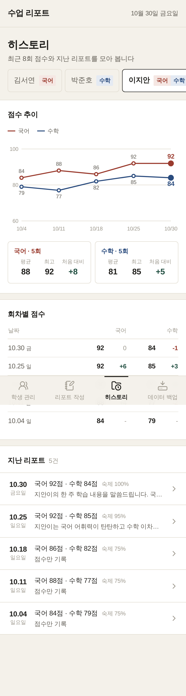
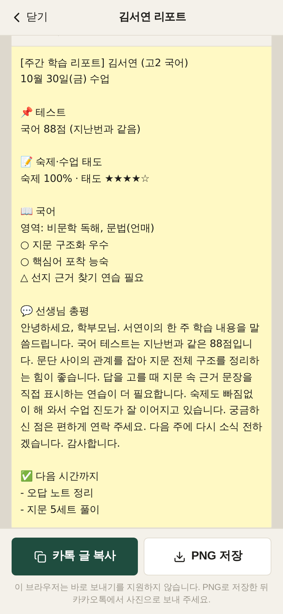
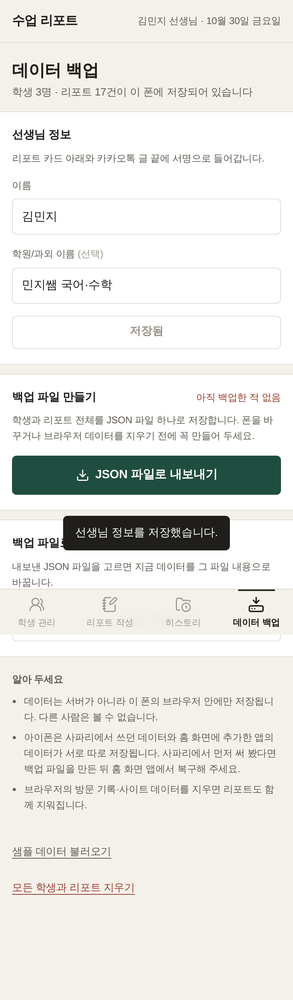
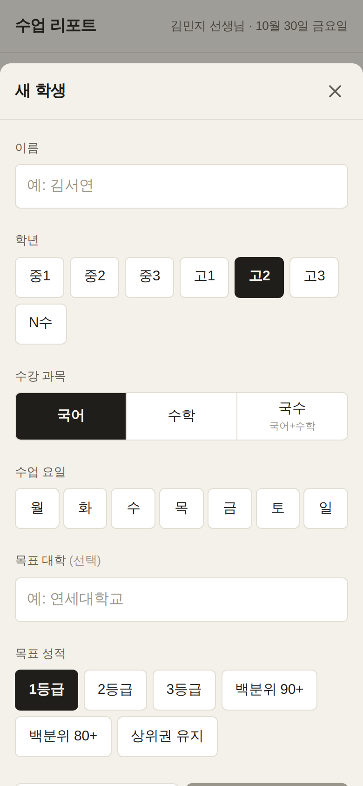

# 과외 수업 리포트

국어·수학 과외 선생님이 수업이 끝나고 폰으로 리포트를 쓰고, 학부모님 카카오톡으로 바로 보내는 웹앱입니다.
서버 없이 동작하며 학생 정보와 리포트는 선생님 폰의 브라우저(LocalStorage)에만 저장됩니다.
홈 화면에 추가하면 앱처럼 전체 화면으로 열리고, 인터넷이 약한 곳에서도 열립니다.

배포와 폰 설치 방법은 [PRIVATE_DEPLOY_GUIDE.md](./PRIVATE_DEPLOY_GUIDE.md)에 단계별로 적어 두었습니다.

## 화면

| 학생 관리 | 리포트 작성 (국어) | 리포트 작성 (수학 오답 비율) |
| --- | --- | --- |
|  |  |  |

| 학부모님께 가는 리포트 카드 | 국어·수학 동시 수강 카드 | 히스토리 |
| --- | --- | --- |
|  |  |  |

| 미리보기와 카톡 글 | 데이터 백업 | 학생 등록 |
| --- | --- | --- |
|  |  |  |

카카오톡으로 복사되는 글의 예시는 [docs/screenshots/06-kakao-text.txt](docs/screenshots/06-kakao-text.txt)에 있습니다.
스크린샷은 GitHub Actions가 빌드할 때마다 아이폰 크기(390×844) 브라우저로 다시 찍습니다.

## 할 수 있는 일

- **학생 관리**: 이름, 학년, 과목(국어/수학/국수), 목표 대학·성적, 수업 요일. 오늘 수업이 있는 학생을 위에 따로 보여 줍니다.
- **리포트 작성**: 자판 대신 칩, 별점, 슬라이더, 점수 버튼으로 입력합니다. 모든 버튼은 44px 이상입니다.
  - 공통: 수업 일자(오늘/어제 원터치), 출결·집중도 별점, 숙제 이행률, 테스트 점수(10점 단위 + ±1/±5, 지난번 점수와 비교)
  - 국어: 수업 영역 6종, 잘한 점·보완할 점 태그 17종
  - 수학: 진도 단원(최근 단원 원터치), 개념 이해도 상/중/하, 오답 원인 5종별 틀린 문항 수와 비율 막대
  - 지난 수업의 영역·단원·과제 불러오기
- **총평 자동 작성**: 고른 태그, 점수 변화, 숙제율, 오답 원인으로 칭찬 중심 / 약점 보완 중심 / 균형형 세 가지 문장을 만듭니다.
  "다른 문장으로 다시 만들기"를 누르면 같은 내용으로 다른 템플릿 문장을 골라 매주 같은 글이 반복되지 않습니다.
  문구는 [src/data/feedbackTemplates.ts](src/data/feedbackTemplates.ts)에 있습니다 (숙제 안내 16, 성적 방향 22, 국어 처방 28, 수학 처방 27, 국어 태그별 코멘트 17).
- **보내기**: 리포트 카드를 PNG로 만들어 폰 공유창(Web Share API)으로 카카오톡 대화방에 바로 보내거나, PNG로 저장하거나, 카톡용 글을 복사합니다.
- **히스토리**: 과목별 최근 8회 점수 추이, 평균·최고·처음 대비, 회차별 변화, 지난 리포트 열람·수정·삭제.
- **데이터 백업**: 선생님 이름(리포트 서명), 전체 데이터 JSON 내보내기/불러오기, 마지막 백업 날짜 안내, 샘플 데이터, 전체 삭제.

## 개발

```bash
npm install
npm run dev       # 개발 서버
npm run build     # 타입 검사 + 배포용 빌드 (dist/)
npm run preview   # 빌드 결과 미리 보기
npm run icons     # public/icons 의 PNG 아이콘 다시 만들기
```

Vite + React + TypeScript + Tailwind CSS + lucide-react, 이미지 변환은 html-to-image를 씁니다.
점수 그래프는 라이브러리 없이 SVG로 직접 그립니다.

```
src/
  App.tsx                     앱 틀, 하단 탭, 탭 사이 공유 상태
  components/tabs/            학생 관리 / 리포트 작성 / 히스토리 / 데이터 백업
  components/report/          리포트 카드, 점수 그래프, 오답 비율 막대, 미리보기
  components/ui/              칩, 별점, 슬라이더, 스텝퍼, 점수 입력 등
  data/feedbackTemplates.ts   총평 문구와 자동 조합
  lib/storage.ts              LocalStorage 저장/조회
  lib/share.ts                카톡 글, PNG 변환, 공유
  lib/backup.ts               JSON 백업/복구
public/
  manifest.json, sw.js        홈 화면 설치, 오프라인
.github/workflows/ui-preview.yml   빌드 검사와 스크린샷
vercel.json                   Vercel 배포 설정
```

## CI

`.github/workflows/ui-preview.yml`은 push와 PR마다 `npm install`과 `npm run build`를 돌려 타입·빌드 오류를 확인하고,
Playwright로 주요 화면을 찍어 Actions 아티팩트(`ui-screenshots`)와 `ui-shots` 브랜치에 올립니다.
